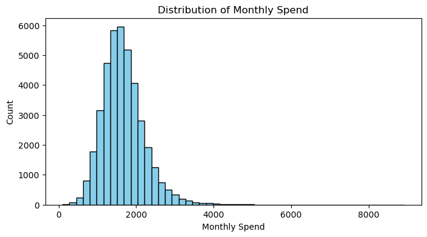
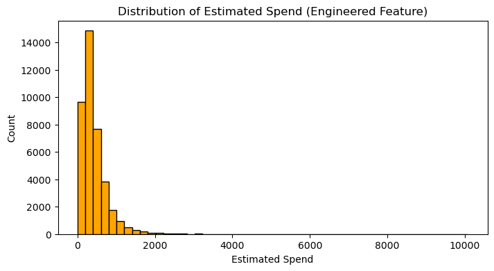

# Credit Card Spending Forecast (Kaggle Competition)

**Ranked 50th of 354 (top 15%)** in Columbia University's Applied Machine Learning Predictive Analytics Competition, hosted on Kaggle. A stacking ensemble predicted each customer's monthly credit card spend with an RMSE of **247.41** on the public leaderboard. That error is **~53% lower** than a predict-the-average baseline (RMSE ~537).

## Problem

Predict `monthly_spend` for 10,000 credit card customers from demographic, credit and behavioral data. The model was trained on 40,000 labeled customers with 22 raw features. Submissions were scored by **RMSE (Root Mean Squared Error)**: the typical size of a prediction miss, in dollars, with large misses penalized more.

## Approach

1. **Exploration:** profiled data types, value ranges and missing values (education level, online shopping frequency and utility payments had gaps), then checked the target's distribution.
2. **Feature engineering:** added 7 features. This step had the biggest impact.
    - `estimated_spend` = transactions × average transaction value (a direct spend proxy)
    - Ratios: `limit_to_income_ratio`, `online_tx_ratio`, `tx_per_card`
    - Interactions: `score_x_limit`, `age_x_income`
    - Polynomial: `credit_score_sq`
3. **Pipeline:** a scikit-learn `Pipeline` + `ColumnTransformer` with median imputation and scaling for numeric columns, and mode imputation and one-hot encoding for categorical columns. Putting every step in one pipeline prevents train/test mismatches.
4. **Model:** a `StackingRegressor` whose base models are Random Forest, Gradient Boosting and Ridge, blended by a `LassoCV` meta-model.
5. **Validation:** 5-fold cross-validation, which gives a more stable estimate than a single train/test split.

## Results

| Approach | Validation | RMSE |
| --- | --- | --- |
| Baseline: predict the mean | Training data | ~537.3 |
| Early: manual preprocessing, RF + GB blended with linear regression | Single 85/15 split | 257.25 |
| **Final: engineered features + pipeline + stacking ensemble** | **5-fold CV** | **250.11 ± 2.05** |
| **Final, Kaggle public leaderboard** | Hidden test set | **247.41 (rank 50 / 354)** |

The early and final rows used different validation methods, so they are not a strict head-to-head comparison.

<p>
  
  
</p>

## What I learned

- Feature engineering improved results more than model complexity did.
- Automated pipelines removed the column-alignment bugs of manual preprocessing.
- A regularized meta-model (`LassoCV`) blended base models better than plain linear regression.
- K-fold cross-validation gave trustworthy error estimates, while a single split was noisy.

## Repository structure

```
├── notebooks/
│   ├── 01_final_stacking_pipeline.ipynb   # best submission, full report with outputs
│   └── 02_early_experiments.ipynb         # earlier manual approach, for comparison
├── src/
│   └── train.py                           # final pipeline as a runnable script
├── data/README.md                         # where the competition data goes (not included)
├── images/                                # charts used in this README
└── requirements.txt
```

## How to run

```bash
pip install -r requirements.txt
# put analysis_data.csv and scoring_data.csv in data/ (see data/README.md)
python src/train.py                 # prints baseline + 5-fold CV RMSE, writes submission.csv
python src/train.py --skip-cv       # faster: fit and predict only
```

**Tools:** Python, pandas, NumPy, scikit-learn (Pipeline, ColumnTransformer, StackingRegressor, RandomForest, GradientBoosting, Ridge, LassoCV), matplotlib, Jupyter
